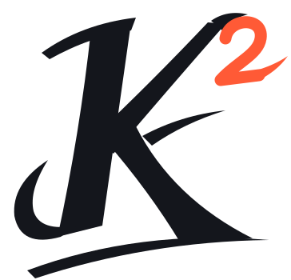
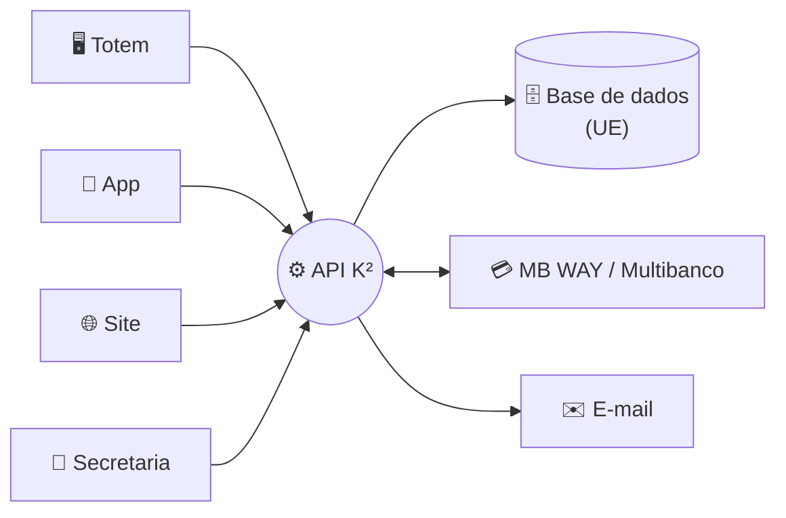

<picture>
  <source media="(prefers-color-scheme: dark)" srcset="./assets/k2-logo-tinta-clara.svg">
  
</picture>

### Tecnologia simples para quem serve pessoas.

Criamos sistemas de pedidos e pagamentos para **cantinas escolares** e **restauração**, com totem tátil, app e site, para acabar com filas, senhas em papel e contas feitas à mão.

 

---

## 🍽️ KlikaAqui

O nosso primeiro produto. Nasceu como projeto de PAP numa escola profissional de Lisboa e está a crescer até ser um sistema completo para refeitórios e bares.

<table>
  <tr>
    <td width="50%" valign="top">
      <h4>🖥️ Totem</h4>
      Ecrã tátil à entrada do refeitório. O aluno entra, vê a ementa, reserva o almoço e recebe o talão com o PIN da refeição.
    </td>
    <td width="50%" valign="top">
      <h4>📱 App &amp; site</h4>
      Reservar a partir de casa, carregar saldo com <b>MB WAY</b> ou <b>Multibanco</b> e consultar o histórico.
    </td>
  </tr>
  <tr>
    <td width="50%" valign="top">
      <h4>🧾 Painel da secretaria</h4>
      Gestão de contas, carregamentos ao balcão, ementas e notícias, tudo num só sítio.
    </td>
    <td width="50%" valign="top">
      <h4>🔒 Dinheiro bem guardado</h4>
      Cada cêntimo fica registado num histórico que não se apaga, e o saldo só muda no servidor.
    </td>
  </tr>
</table>

### Como funciona

Todas as peças falam com uma única **API**. Assim, as regras do dinheiro vivem num só sítio e cada nova peça, seja um ecrã de cozinha ou um restaurante novo, liga-se sem mexer no resto.

## 🛠️ Com que trabalhamos

  
  
  
  
  
  
  

## 🗺️ Onde estamos

- [x] Protótipo do totem (PAP)
- [x] Nova API com saldo seguro, reservas e carregamentos
- [ ] Totem no ecrã tátil novo + MB WAY real
- [ ] **Piloto numa escola de Lisboa**, janeiro 2027
- [ ] Mais escolas e os primeiros restaurantes

## 👋 Quem somos

O **K²** são dois irmãos, **Kaique** e **Kauã**: dois *K*, daí o quadrado. Somos programadores em Lisboa e estamos a construir o que gostávamos de ter tido na cantina da nossa escola.

**Tens uma cantina, um bar ou um restaurante?** Fala connosco.

 

Feito com ☕ em Lisboa · © 2026 K²

